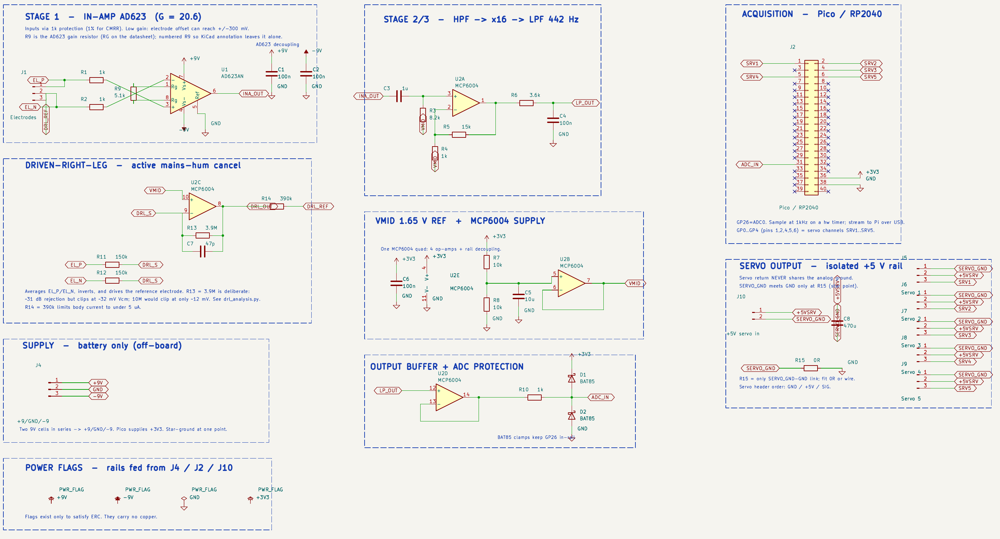
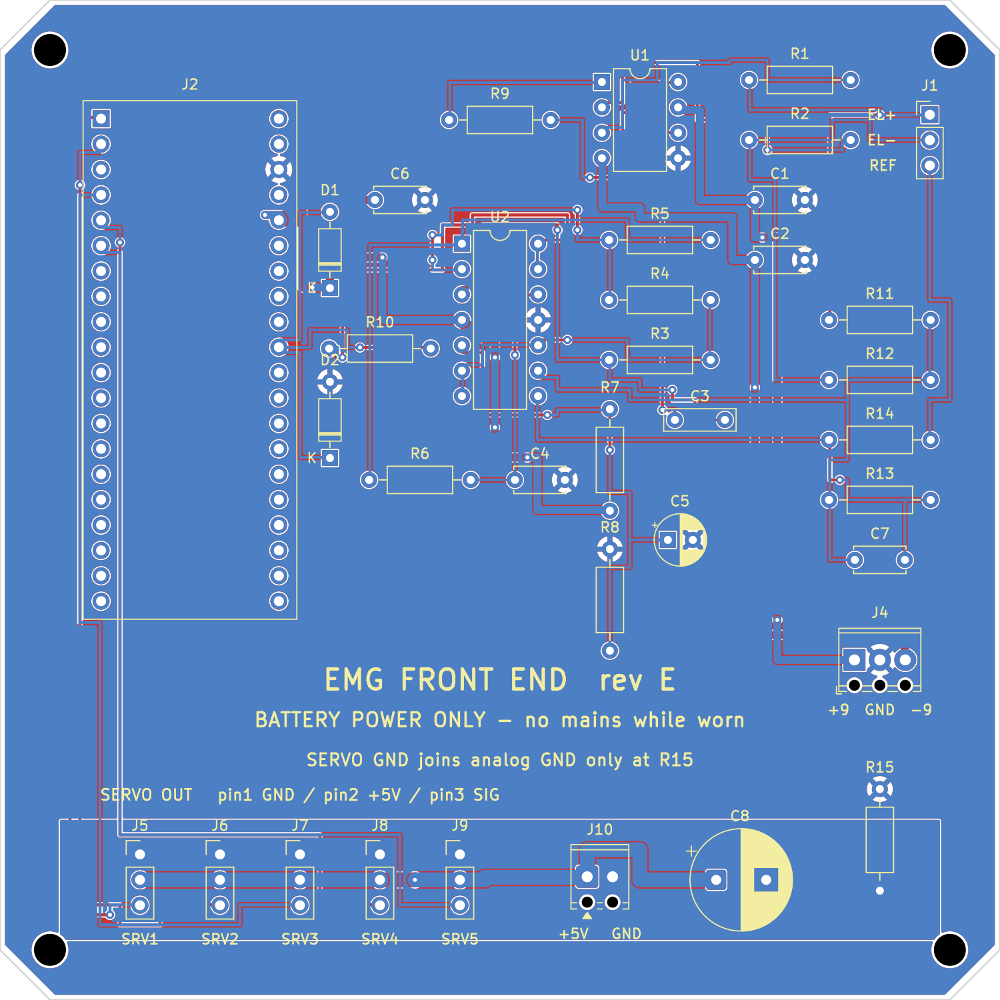

# EMG-Controlled Robotic Hand

A wearable single-channel surface-EMG front end that reads how hard a forearm
muscle contracts and drives a robotic gripper proportionally. The whole control
loop runs on a Raspberry Pi Pico rather than on a PC: squeeze harder and the
grip closes further, relax and it opens.

> ### Safety: read this before building anything
>
> This is an experimental, self-built device that puts electrodes on skin. It
> is not a medical device, has not been certified, and must not be used for
> diagnosis, monitoring, or any clinical purpose.
>
> - **Battery power only.** Never wear the electrodes while anything in the
>   signal path is connected to mains. The driven-right-leg (DRL) circuit
>   actively drives the reference electrode; R14 (390 kΩ) holds body current
>   under 5 µA, but that only holds while the board is isolated from mains.
>   Powering the Pico from a laptop that is plugged in to charge defeats it, so
>   run the host on its own battery whenever electrodes are on skin.
> - The board carries the silkscreen legend **"BATTERY POWER ONLY - no mains
>   while worn"** and has no provision for a mains adapter.
> - Build and use it at your own risk.

## Status

The rev E board is built and the digital side works on real hardware. The
analog front end has not been powered yet, so no EMG has been recorded from
skin. What has been checked so far:

| Part | State |
|---|---|
| Analog front end (rev E) | Designed, DRC-clean, fabricated at JLCPCB and hand-soldered. Servo section (J5-J9, J10, C8) left unpopulated. C3 not fitted yet. The +/-9 V rails are not connected, so the front end itself is unverified |
| Firmware logic | 77 native tests pass (DSP, safety FSM, control law, protocol) |
| Firmware on hardware | Builds with PlatformIO, flashed to the Pico, enumerates over USB |
| Telemetry link (bring-up gate 4) | Passes. 10 s capture: 499 frames at 49.87 frames/s, 997.4 Hz sample rate, 0 CRC errors, 0 dropped frames, 0 resyncs |
| Host tools | Python test suite passes against a simulator, and `host.cli monitor` runs against the real board |
| On-body EMG | Not done. Next steps are in [`board/revd/bringup.md`](board/revd/bringup.md): connect +/-9 V (check polarity first), check rails and VMID, fit C3, then stage 5 on battery |

A few fitted resistors differ from the schematic because I did not have the
exact values (R5 = 10k, R6 = 3.3k, R11 = R12 = 100k, R13 = 3.3M, R14 = 470k).
Total gain is about 227 instead of the designed 336. Anything not listed as
passing above should be treated as unverified.

## How it works

```
electrode (forearm)                        Raspberry Pi Pico (RP2040)
   │  ~a few hundred µV                        │
   ▼                                           ▼
AD623 in-amp  ─►  MCP6004 gain + 442 Hz LPF ─► ADC0 @ 1 kHz ─► 20 Hz HPF,
   (×20.6)          (×16, total ≈ 330)         │               50/100/150 Hz notches,
                                               │               rectify + 200 ms RMS envelope
   driven-right-leg mains rejection            │
                                               ▼
                                        safety state machine ─► proportional
                                        (INIT/IDLE/ACTIVE/HOLD/                map + slew limit
                                         FAULT/latched ESTOP)                       │
                                                                                    ▼
                                                                            servo PWM ─► geared gripper
```

- The control loop runs entirely on the Pico. The host (a Mac or a Pi 5 over
  USB) only plots, calibrates, and logs, so if you unplug it the gripper keeps
  working.
- One EMG channel measures how hard the muscle is working, not which hand
  posture you are making. Contraction strength maps continuously onto grip
  aperture, which suits a one-degree-of-freedom gripper. There is no gesture
  classifier, no training data, and no ML model to run at runtime. (More in
  [`firmware/pico_emg/README.md`](firmware/pico_emg/README.md).)
- There are no force sensors on the board, so the firmware uses signal quality
  itself as a safety check: it watches for saturation, flat-line, DC drift, and
  stale data, and releases the grip on a sustained fault instead of freezing it.

Key numbers: about 330× total gain, 2.443 µV per ADC count referred to skin,
1 kHz sampling, 442 Hz single-pole anti-alias, DRL mains rejection, and a
100 × 100 mm 2-layer through-hole board.

## Hardware

The analog front end is a single KiCad project (rev E). Full sources, exported
gerbers, and fab notes are under [`board/revd/`](board/revd/).

**Schematic.** Two-stage gain, driven-right-leg mains rejection, VMID
reference, ADC clamp protection, and the isolated servo-output block:



**PCB.** 100 x 100 mm, 2-layer, all through-hole:



## Repository layout

| Path | What |
|---|---|
| [`board/revd/`](board/revd/) | The rev E analog front end: KiCad sources, exported gerbers, and the [`constraints`](board/revd/constraints.md) / [`fab`](board/revd/fab.md) / [`bringup`](board/revd/bringup.md) docs. (The directory is named `revd` for historical reasons; the board it holds is rev E.) |
| [`firmware/pico_emg/`](firmware/pico_emg/) | RP2040 firmware: header-only DSP, safety FSM, control law, PICO1 telemetry, and 77 native logic tests |
| [`host/`](host/) | USB observer (plot / calibrate / log), deliberately not in the control loop |
| [`tests/`](tests/) | Host-side tests, including wire-format parity against the firmware |
| [`docs/wiring/`](docs/wiring/) | LaTeX wiring / connection guide |

*The 3D-printable gripper CAD is being reworked and will be added in a later
update.*

## Build & test

```bash
# Firmware: Raspberry Pi Pico / RP2040 (PlatformIO)
cd firmware/pico_emg
pio run -e pico            # builds firmware.uf2
./test/run_tests.sh        # 77 native logic tests (compiles the real headers)

# Host tools: Python, from the repo root
python3 -m pytest                        # host test suite
python3 -m host.cli selftest             # no hardware needed
python3 -m host.cli --simulate monitor   # run the pipeline against simulated EMG
```

## Bring-up

If you fabricate the board, work through
[`board/revd/bringup.md`](board/revd/bringup.md) top to bottom and do not skip a
failed gate. Several stages put voltage near skin, and stages 4–6 need the host
running on battery, unplugged from mains. Only when every gate passes with real
numbers should any part of this be described as working.

## License

[MIT](LICENSE) © 2026 Paing Hein Htet.
